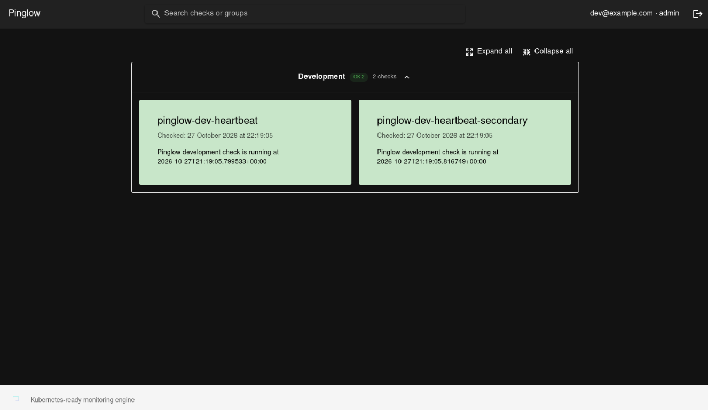

# Pinglow

  

<strong>A monitoring engine for Kubernetes.</strong>

Pinglow is an open-source monitoring engine for Kubernetes. Describe what matters to you as Kubernetes resources, bring your own checks, and let Pinglow take care of running them and keeping track of the results.

For more information about it please read the [Pinglow Documentation](https://sbettid.github.io/pinglow/).

## Checks and results

Create `Check` and `Script` resources to run Python checks on a schedule, or report results from external systems with passive checks. Pinglow's controller queues work for its runners; results and performance data are saved so you can understand not just whether a check failed, but how it has been behaving over time.

Connect checks to Telegram channels for failure notifications, explore results and performance graphs in the [web UI](https://github.com/sbettid/pinglow-frontend), or integrate your own tools through the REST API.

## ☸️ Made for your cluster

Manage checks, scripts, and notification channels alongside the rest of your Kubernetes configuration, and deploy Pinglow with the included Helm chart. Need a team-friendly setup? Optional OIDC single sign-on works with role-based permissions for viewers, operators, and admins.

Pinglow is written in Rust and developed in my free time. It is an evolving project, and contributions, ideas, and feedback are always welcome.

## Web interface

The [Pinglow web frontend](https://github.com/sbettid/pinglow-frontend) can also be deployed to explore check status and performance data (and much more actually!): 

## 🚀 Take a look

Curious to see it in action? Start with the **[quick start](https://sbettid.github.io/pinglow/docs/deployment/quick-start)**, explore the **[full documentation](https://sbettid.github.io/pinglow/)**, or visit the **[frontend project](https://github.com/sbettid/pinglow-frontend)**. 

The docs also cover [deployment](https://sbettid.github.io/pinglow/docs/deployment), [OIDC authentication](https://sbettid.github.io/pinglow/docs/deployment/oidc), and the [REST API](https://sbettid.github.io/pinglow/docs/restapi).

## Local development

In case you are interested in contributing, you can follow the [local development guide](./dev/README.md) to run Pinglow with Kind.